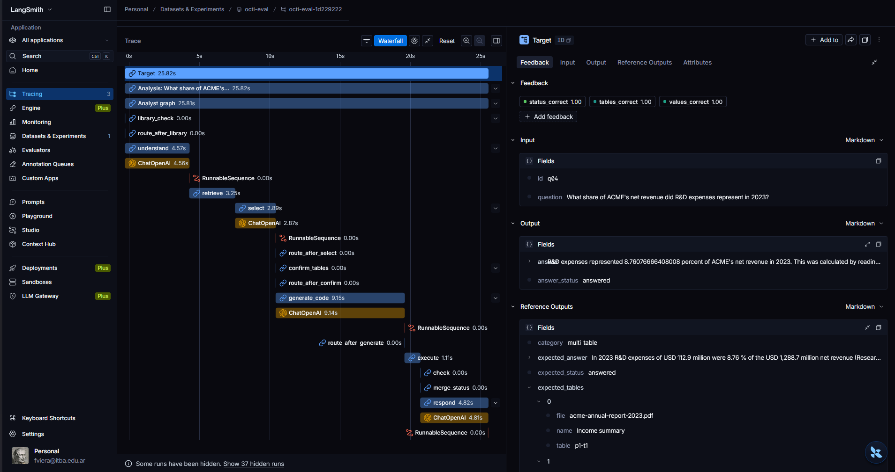
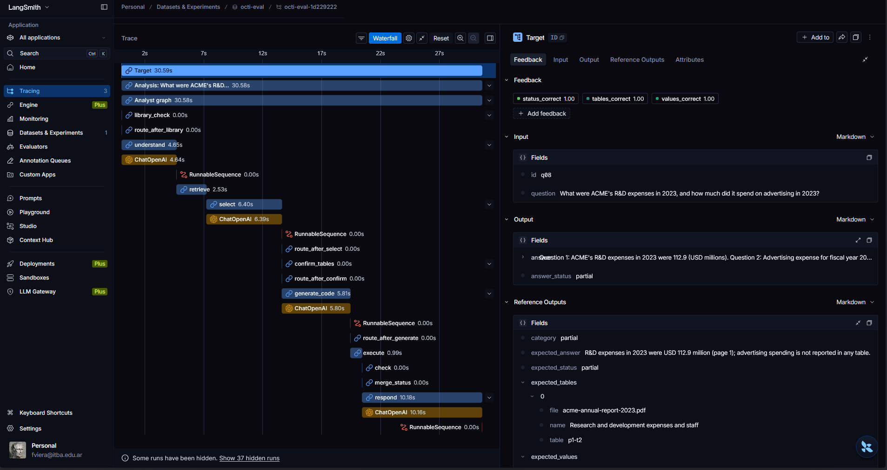
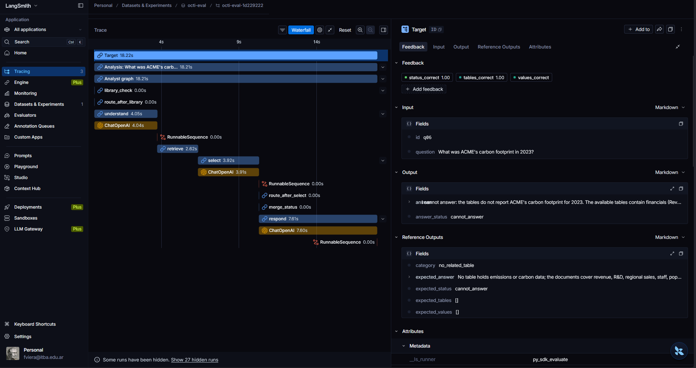

# Evaluation

Octi is evaluated on 10 test questions over the two sample PDFs in `data/sample_pdfs/`. Each question
has an expected Answer status (`answered`, `partial` or `cannot_answer`), the expected numbers (1 %
tolerance), the Tables the Analyst should use, and an expected answer written for humans
(`eval/questions.yaml`). Every expected number is checked against the data the sample PDFs were
generated from, so the reference answers cannot drift from the documents.

## How to run

```bash
python -m scripts.run_eval
```

The command works with anyone's own `.env` (LiteLLM, Pinecone, LangSmith and Docker): it ingests the
sample PDFs if they are not in the library yet, syncs the questions to the LangSmith dataset
`octi-eval`, runs every question through the Analyst graph as one LangSmith experiment (each run
tagged `eval`), scores it, and writes `eval/results.md`.

Scoring is plain code — no model grades another model:

| Check | Passes when |
|---|---|
| `status_correct` | the Answer status stored in the graph state equals the expected one |
| `values_correct` | every expected number appears among the computed values (1 % tolerance; a percentage may come as a fraction); not applicable to `cannot_answer` |
| `tables_correct` | every expected Table is among the Tables the Analyst used; for a `cannot_answer` question, no Table was used |

## Run details

- Run date: 2026-10-12 03:31 UTC
- Model: `gpt-5-mini` (all agent calls)
- Commit: `8e20659`, with the table-check correction described below (`eval/scoring.py`,
  `eval/questions.yaml`; committed right after this run)
- Experiment: `octi-eval-1d229222`

## Results

| id | Category | Question | Expected | Actual | Status | Values | Tables | Retries |
|---|---|---|---|---|---|---|---|---|
| q01 | single table | What was ACME's net revenue in 2023? | answered | answered | ✓ | ✓ | ✓ | 0 |
| q02 | scale conversion | Using the monthly sales table, what were ACME's total net sales in 2022, in USD millions? | answered | answered | ✓ | ✓ | ✓ | 0 |
| q03 | Spanish question | ¿Cuál fue la tasa de desempleo de Cuyo en 2023? | answered | answered | ✓ | ✓ | ✓ | 0 |
| q04 | multi-table | What share of ACME's net revenue did R&D expenses represent in 2023? | answered | answered | ✓ | ✓ | ✓ | 0 |
| q05 | multi-table, two PDFs | What were ACME's net sales per inhabitant in Patagonia in 2023, in USD? | answered | answered | ✓ | ✓ | ✓ | 0 |
| q06 | no related table | What was ACME's carbon footprint in 2023? | cannot_answer | cannot_answer | ✓ | – | ✓ | 0 |
| q07 | missing year | What was ACME's net income in 2019? | cannot_answer | cannot_answer | ✓ | – | ✓ | 0 |
| q08 | two parts, one missing | What were ACME's R&D expenses in 2023, and how much did it spend on advertising in 2023? | partial | partial | ✓ | ✓ | ✓ | 0 |
| q09 | missing comparison value | What was ACME's market share in Patagonia in 2023, and how does it compare with ACME's national market share? | partial | cannot_answer | ✗ | ✗ | ✓ | 2 |
| q10 | ambiguous column | What was ACME's revenue in 2022? | cannot_answer | cannot_answer | ✓ | – | ✓ | 0 |

**Totals:** status **9/10** · values **6/7** (3 not applicable) · tables **10/10**.

## Scoring change before this run

The first version of `tables_correct` compared the Table names in `eval/questions.yaml` with the
names of the Tables the Analyst used. Those names are generated by the LLM when a PDF is ingested
(for example "Income summary, 2021-2023 (USD millions)" instead of "Income summary", and always in
English, so a Spanish reference name never matched). The check therefore failed whenever the wording
differed, independently of whether the right Table was used.

The check now identifies Tables by facts fixed by the PDF: its file name and the `p<page>-t<position>`
part of its `table_id`, which is computed from the PDF's bytes, page and position and never changes
between runs. A name is kept in the YAML only as a human label. Status and value scoring are
unchanged; the code change and its test are in `eval/scoring.py`, `eval/questions.yaml` and
`tests/unit/test_eval_scoring.py`.

For transparency, the previous run on the same commit (2026-10-12 03:18 UTC, experiment
`octi-eval-bed5cb83`) had the same statuses and values (9/10 and 6/7) and recorded tables 4/10 with
the name-based check: it failed q01–q05, whose computed values were correct — only possible with the
right Tables — and q09.

## Notes

- **q06, q07, q10:** the Analyst refused correctly — no related table (q06), a year outside the
  table's range (q07), and gross vs net revenue left unresolved by the question (q10) — and showed no
  number.
- **q08:** a two-part question answered partially, as expected: R&D expenses were computed and the
  advertising part was reported as missing.
- **q09 (✗):** expected `partial` (Patagonia's market share is in the regional table; the national
  share is not). The Analyst selected the right Table, and judged the Patagonia part answerable, but
  its code attempts failed (2 retries after the first attempt), so the part ended as failed and the
  run reported `cannot_answer` instead of `partial`. The comparison part was correctly not computed.
- An earlier run on the same commit failed every question that needed code with a sandbox error,
  because the Docker daemon was not reachable from that shell; the three `cannot_answer` questions,
  which need no code, were correct in that run too.

## Representative traces

Screenshots from LangSmith, one per behaviour:

| Behaviour | Question | Screenshot |
|---|---|---|
| `answered`, multi-table (income summary + R&D table) | q04 | `eval/answered-multi-table.png` |
| `partial`: one part computed, one reported missing | q08 | `eval/partial.png` |
| `cannot_answer`: no related table, no number shown | q06 | `eval/cannot-answer.png` |





## Limitations

- 10 questions over two generated PDFs are a small, controlled set; real reports have layouts the
  set does not cover (see the README's known limitations for extraction).
- One run per configuration: model outputs vary between runs even at the same settings, so a single
  run does not measure consistency.
- q09 shows that a failing calculation for one part turns a partial answer into `cannot_answer`:
  the retry budget (`ANALYST_MAX_RETRIES`, default 2) was not enough for that question.
- The evaluation runs with table confirmation off (the human-in-the-loop pause is a UI step); the
  pause itself is exercised by the offline tests.
