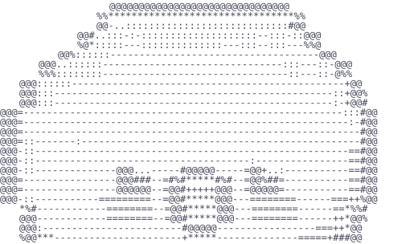
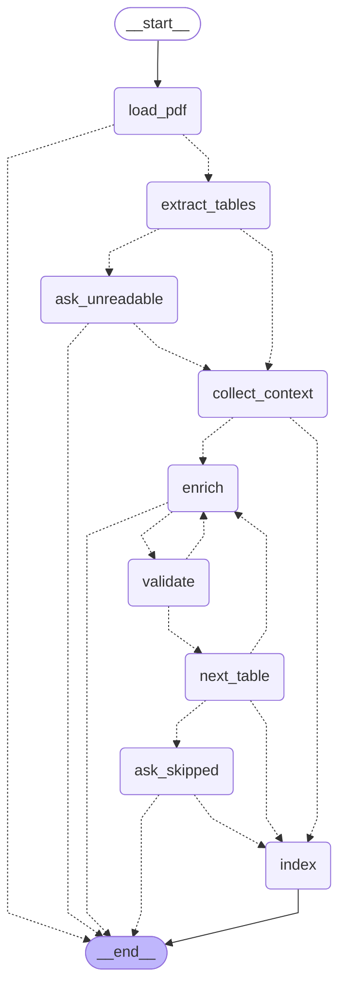
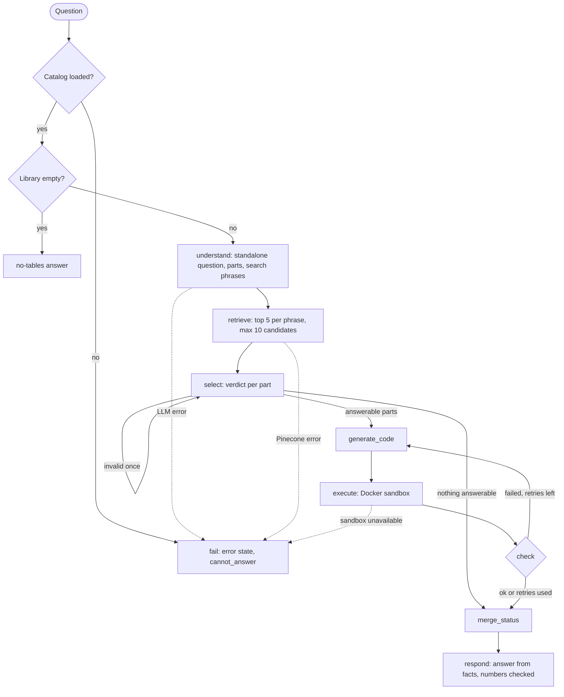

<p align="center">
  
</p>

<h1 align="center">Hi, I'm Octi!</h1>

Octi answers questions about the tables inside PDF reports. An **Ingestion agent** extracts each
table, describes it with an LLM and indexes it in Pinecone; an **Analyst agent** finds the tables a
question needs, writes and runs Python to compute the answer, and says whether the question was
`answered`, `partial` or `cannot_answer`.

> **Status.** The Ingestion agent is complete in the app: attach a PDF, follow the run in the chat,
> answer any pauses, and browse the results in the Library. The Analyst agent — retrieval, table
> selection, code generation, isolated execution in a Docker sandbox, self-correction and the
> `answered` / `partial` / `cannot_answer` decision — is implemented and covered by the offline test
> suite; in the chat, questions are not yet routed to it and receive a placeholder reply.

## Getting started

### Prerequisites

- Python 3.11 or newer (developed on 3.13).
- A key for LiteLLM proxy and its base URL.
- A [Pinecone](https://www.pinecone.io/) account (API key).
- A [LangSmith](https://smith.langchain.com/) account (API key), for tracing.
- Docker running locally, with the sandbox image built below.

Run every command below from the repository root.

### 1. Create a virtual environment and install the dependencies

```bash
python3 -m venv .venv
source .venv/bin/activate          # Windows PowerShell: .venv\Scripts\Activate.ps1
pip install -r requirements.txt
```

Every dependency is pinned with `==`, so a fresh environment installs the same versions.

### 2. Configure your secrets

```bash
cp .env.example .env
```

Fill in `.env`. `.env.example` lists every variable with a comment; the required ones are
`LITELLM_BASE_URL`, `LITELLM_API_KEY`, `LLM_MODEL`, `EMBEDDING_MODEL`, `LANGSMITH_API_KEY` (while
tracing is on) and `PINECONE_API_KEY`. The optional ones (timeouts, retries, temperature, index
name, namespace, log level) have working defaults and stay commented out.

`INGESTION_MAX_RETRIES` defaults to 2 (allowed 0–5): each table gets one initial description attempt
and at most that many corrections after deterministic validation. The ingestion model is always
`LLM_MODEL`; the chat model picker does not change it.

Security notes:

- `.env` is already listed in the repository's `.gitignore`, so git leaves it out of commits.
- Recommended on Linux and macOS: `chmod 600 .env`, so only your user can read it.
- The service check (step 4) fails with a clear message if git ever tracks `.env`.
- Octi never shows a key: configuration errors name the variable, never its value; log lines have
  every configured secret replaced by `***`; the app and the scripts show only messages Octi wrote,
  never raw text from a library or the proxy.
- A value left empty (`KEY=`) counts as missing.

### 3. Create the Pinecone index

```bash
python -m scripts.setup_index
```

Creates the Pinecone index named by `PINECONE_INDEX_NAME` (default `octi-tables`), with
`EMBEDDING_DIMENSION` dimensions (default 1536) and the cosine metric. Safe to run again: it never
deletes or changes an index. An index you already have works too, as long as its name, dimension
and metric match. The app never creates the index; it only checks it.

### Build the sandbox image

```bash
docker build -t octi-sandbox:1 sandbox/
```

The startup check requires a reachable Docker daemon and this image. The sandbox is used for
calculations; ingestion reads PDF data in the app process and does not execute generated code.

### 4. Check every service

```bash
python -m scripts.check_services
```

One line per check, in this order: configuration, models, chat, embeddings, pinecone, langsmith,
docker, git. Each line reads `OK`, `FAIL: <what to do>` or `skipped (<why>)`. Exit code 0 means nothing
failed. It makes one real chat call and one real embedding call (a little of your proxy budget), and
takes under a minute when every service is healthy. Run it first whenever something does not work.

```text
configuration: OK
models: OK
chat: OK
embeddings: OK
pinecone: OK
langsmith: OK
docker: OK
git: OK
```

### 5. Run the tests

```bash
.venv/bin/python -m pytest -q       # offline; no service calls
.venv/bin/python -m pytest -m live  # explicit checks against real services
```

The default run is offline by construction: a guard fails any test that opens a network
connection, another fails any test that loads the real `.env`, and every model, embedding,
Pinecone and LangSmith client is a stub with fake keys. Tests check that those fake keys never
appear in any output. The live test runs the same code as the service check, so the two cannot
disagree. The live ingestion test checks the ACME sample's five tables, pages, ids and Parquet
files without asserting model wording. It uses a unique temporary namespace and Table store,
and removes its records and files afterwards. Live checks use your proxy budget.

### 6. Run the app

```bash
streamlit run app.py
```

At start-up the app checks the configuration, Pinecone index and calculation sandbox once (no LLM call, so opening
the app costs nothing). If something is wrong, Octi's error screen says what failed, what to do,
and which section of this README to read. The check runs once per server process: after you fix
`.env` or create the index, **restart** the app.

### Add and browse tables

Attach one machine-readable PDF with **+** in the composer. Its bytes stay in memory; Octi never
saves the uploaded PDF. Text submitted with it is handled after ingestion finishes.

- An identical file opens a confirmation with **Keep** or **Open in library**; it is not indexed again.
- A different file with the same name asks **Replace** or **Cancel**, showing the existing table count.
- The chat streams opening, extraction, context, description attempts and indexing. Unreadable
  parts pause with **Continue** or **Cancel ingestion**; skipped descriptions pause before indexing
  the remaining tables. If no table can be processed, only cancellation is offered.
- The composer waits during the run and its pauses. Sidebar navigation also waits while streaming.
  **New chat** at a pause abandons the run without writing or deleting tables.
- Results remain in the conversation: expandable table cards contain names, descriptions, pages,
  columns, units, dtypes, the first ten row labels and a scrolling preview. Skipped parts and image
  notes follow the cards. **Open in library** selects that document.
- The Library groups tables by document, newest first, with a document dropdown. Sidebar Document
  names navigate to it; table names are plain text. **View all** and **Show more** expand locally.
- If the catalog cannot be read, questions remain available. An upload retries the catalog read
  before checking duplicates or replacements; if it still fails, ingestion does not start.

Try the committed samples in `data/sample_pdfs/`: the ACME annual report has five tables including
one across pages 4–5; the regional report has two Spanish tables. Regenerate both from their
versioned data with:

```bash
python -m scripts.make_sample_pdfs
```

## Project architecture

```text
Octi/
├── app.py                   Streamlit entry point: start-up check, then sidebar + current view
├── requirements.txt         pinned dependencies
├── pytest.ini               test settings (live tests excluded by default)
├── .env.example             every configuration variable, with comments
├── .streamlit/
│   └── config.toml          theme (Catppuccin Mocha) and fonts
├── assets/
│   ├── styles.css           global stylesheet (palette as CSS variables)
│   ├── octi.svg             browser-tab icon
│   ├── readme-head.svg      README header image
│   └── logo/
│       ├── frame_*.txt      animated ASCII logo, one frame per file
│       └── error/
│           └── frame_*.txt  error-screen logo frames
├── services/                back end, one module per concern (no Streamlit)
│   ├── settings.py          configuration: .env → typed Settings (the only reader of the environment)
│   ├── errors.py            error tree
│   ├── logging_setup.py     logging with secret redaction
│   ├── llm.py               LiteLLM proxy: chat and embedding clients, error translation
│   ├── vector_store.py      Pinecone: index checks, catalog reads and record mutations
│   ├── table_store.py       atomic Parquet writes and dtype-preserving reads
│   ├── sandbox.py           isolated calculation execution and startup check
│   ├── tracing.py           LangSmith: client and error translation
│   └── health.py            service check, shared by the script and the live test
├── scripts/
│   ├── setup_index.py       creates the Pinecone index
│   ├── make_sample_pdfs.py  deterministic sample PDF generator and table-data constants
│   └── check_services.py    checks every service, one line each
├── ui/                      the Streamlit app
│   ├── startup.py           configuration/index/sandbox checks, cached per process
│   ├── sidebar.py           wordmark, New chat, Library, Documents, status button
│   ├── chat.py              Chat view: empty state, history, composer, model picker
│   ├── library.py           Library view
│   ├── documents.py         sidebar Documents list
│   ├── catalog.py           session catalog and document lookups
│   ├── upload.py            duplicate/replacement confirmations
│   ├── ingestion.py         live run, pause/resume and durable summaries
│   ├── table_card.py        shared cards for the chat and Library
│   ├── new_chat.py          "New chat" confirmation modal
│   ├── error_screen.py      error screen and its messages
│   ├── bubble.py            ASCII speech bubble of the error screen
│   ├── logo.py              animated ASCII logo
│   ├── icons.py             SVG icons
│   └── style.py             loads assets/styles.css
├── tests/
│   ├── conftest.py          offline guards (no network, no real .env) and fixtures
│   ├── stubs.py             fake keys and stand-in clients
│   ├── unit/                one test file per module
│   ├── functional/          the app, driven by Streamlit's AppTest
│   └── live/                smoke test against the real services (pytest -m live)
├── agents/analyst/
│   ├── graph.py             StateGraph, routes, run labels and trace masking
│   ├── state.py             analysis state and dependencies
│   ├── nodes.py             understand → retrieve → select → code → sandbox → check → status → answer
│   ├── schemas.py           query plan, selection, code draft, part outcomes, final answer
│   ├── prompts.py           the four prompts and the shared answerability rules
│   ├── checks.py            selection checks, attempt classification, status merge, number check
│   └── prelude.py           trusted script prelude: tables and the emit() result contract
├── agents/ingestion/
│   ├── graph.py             StateGraph, routes, streaming and tracing
│   ├── state.py             light state, dependencies, per-run in-memory store
│   ├── nodes.py             PDF → context → enrichment/validation → indexing
│   ├── schemas.py           extracted tables, enrichment and catalog models
│   ├── prompts.py           frozen prompt, examples and correction messages
│   ├── validation.py        deterministic description checks
│   ├── indexing.py          metadata, embeddings and safe write order
│   └── pdf/
│       ├── document.py      readable pages and significant images
│       ├── tables.py        extraction, headers and multi-page joins
│       ├── cleaning.py      flattened headers and numeric conversion
│       └── context.py       nearby headings, captions and notes
├── data/
│   ├── sample_pdfs/         two generated, committed example PDFs
│   └── tables/              local Parquet data (ignored by Git)
├── sandbox/                 container image definition
├── DECISIONS.md             design decisions, with the alternatives considered
└── CONTEXT.md               glossary of the project's terms
```

## Design decisions

The full log, with the alternatives considered, is in [`DECISIONS.md`](DECISIONS.md).

### Configuration

- `load_dotenv()` copies `.env` into the process environment, so LangChain and LangSmith see their
  own variables.
- One Pydantic model, `Settings`, then parses and validates every variable once, at start-up.
- Keys are `SecretStr`: printing one shows `**********`.
- Any invalid variable stops start-up with one error that names every bad variable, never a value.
- Only `services/settings.py` reads the environment (a test enforces it).

### Errors

- `services/errors.py` defines a small tree:
  - group classes (`ConfigurationError`, `LLMProxyError`, `VectorStoreError`, `TracingError`, …) to
    catch a whole family;
  - leaves (`ProxyUnreachableError`, `IndexMismatchError`, …), the only classes the code raises.
- Each leaf carries a `user_message` that is safe to show.
- The original library exception is chained (`raise … from`) for the logs.
- Each service module translates its library's exceptions, so the rest of the code never sees a raw
  Pinecone or OpenAI error.

### Model calls and retries

- Every chat and embedding call goes through the LiteLLM proxy at `LITELLM_BASE_URL`, with
  `langchain_openai`.
- Defaults: temperature 0, 60 s timeout, `max_retries=2` (3 attempts in total).
- Retries are the OpenAI client's **built-in** ones:
  - exponential backoff with jitter;
  - only for connection errors, timeouts and HTTP 408, 409, 429 and 5xx;
  - a wrong key (401) or a bad request (400) fails at once.
- Why: the *Sistemas Multiagente I* course labs set `max_retries=0` and run their own retry ladder.
  Octi keeps a single retry layer, so attempts are never multiplied, and adds no loop of its own.
- Use short model ids (`gpt-5-mini`): LangChain drops `temperature` only for ids that start with
  `gpt-5`, and those models reject any temperature but the default.

### Pinecone index

- Created only by the setup script (or by you in Pinecone); the app never creates it.
- The app and the service check only read it, and report `ok`, `missing`, `mismatch` (wrong
  dimension or metric) or `unreachable`.
- Any status other than `ok` opens the error screen instead of the app.
- Every record lives in the namespace `PINECONE_NAMESPACE` (default `octi`), so the data can be
  wiped without touching the index.

### Tracing

- With `LANGSMITH_TRACING=true` (the default in `.env.example`), every agent run will be traced in
  the LangSmith project `LANGSMITH_PROJECT`.
- Tracing off is allowed, for example for offline work:
  - the app still opens, and its status button reads "Not traced";
  - the service check marks LangSmith as `FAIL`, because the assignment requires traced runs.
- Ingestion runs are named `Ingestion: <file name>`, tagged `ingestion`, and carry file/hash/pages,
  model, retry limit and thread id metadata. A settings-controlled tracing context keeps tracing
  active even when optional tracing variables were omitted. Each graph node is a span; model
  calls appear beneath enrichment. A shared thread id joins both sides of a pause. Trace links
  are copied from LangSmith for evaluation; the app does not expose tracing tools.

### PDF extraction and descriptions

- PyMuPDF reads table geometry and fonts because multi-row headers and page continuation need
  positions, not just text. **PyMuPDF is licensed under AGPL-3.0.**
- Content that is not a PDF, password-protected documents and documents with no selectable text
  are refused before model calls. An existing OCR text layer counts as selectable text; Octi does
  not create one. Image-only pages are reported as unreadable parts rather than twice as images.
- Only readable, nonempty tables with at least two columns survive filtering. Consecutive page
  parts join when column count and header evidence agree. Merged header levels flatten with ` / `;
  unnamed and duplicate columns receive unique names.
- Header clues are merged cells, bold labels above plain data, or nonnumeric labels; plain years
  from 1900 to 2100 count as labels. At most three header rows are used and a data row remains.
- Numeric parsing is all-or-nothing per column, preserving codes with leading zeros and whole
  values outside signed int64 range as text. Currency symbols and percent hints retain their
  original meaning; percentages keep their printed scale.
- Nearby headings, captions, paragraphs and footnotes explain the table. Geometry excludes other
  columns, repeated running text and table cells; context totals at most 2,000 characters.
- Context blocks must overlap at least half the narrower width of the block and table. Repetition
  rules apply only from three pages and exclude content appearing on more than half the pages.
  Image repetition is identified by pixel-content hash; nonrepeated images covering at least 2%
  of a text page are reported, while their contents are not interpreted.
- The model supplies English meaning only. Code supplies ids, pages, exact column names, dtypes
  and row labels. PDF text is fenced as untrusted data, including backticks inside it. Two examples
  establish the output shape; deterministic validation checks shape, columns, empty/generic
  wording and percent units. Correction attempts receive the previous answer and feedback.
- PDF bytes, open documents and full DataFrames stay outside the traced state in a per-run store.
  The state carries at most twenty rows per table; completion, cancellation or abandonment closes
  the store. Pauses use an in-memory checkpointer because browser-session persistence is not needed.

### Table storage and catalog

- Parquet preserves table columns and numeric dtypes for calculations. Writes use a temporary file
  and atomic rename; reads restore text columns and missing values exactly. Table ids are validated
  as file names rather than paths.
- Each id combines the first sixteen SHA-256 characters of the PDF bytes, first page and table
  position. Re-ingesting the same bytes overwrites the same ids instead of creating duplicates.
- The embedding describes name, meaning, columns/units and the first fifty row labels, omitting
  filenames and pages so retrieval matches meaning. Catalog metadata includes exact facts and a
  preview: column names plus five rows, forty characters per cell, at most 2,000 characters.
- A **38 KB** UTF-8 JSON guard skips oversized metadata before storage rather than truncating it.
- Replacement first reads same-name records with paginated `fetch_by_metadata`, then embeds,
  writes Parquet, upserts records, and removes obsolete records before their files. Failures before
  cleanup roll back only newly created ids and preserve the previous version. A cleanup failure
  keeps the new version and reports possible leftovers; another upload can clean them up.
- The session catalog loads from index records and is updated from each successful run's own
  results, because index listing is eventually consistent. Cards and previews need no disk read.
- The two pauses occur before any write: unreadable parts before description, then skipped tables
  before indexing. Cancelling either leaves the prior document unchanged.

### Ingestion workflow

This diagram is exported from the compiled graph. Dotted arrows are conditional routes; ending
early means a refused document, cancellation or an outage. Validation can return to enrichment
until the correction limit is reached, then advances to the next table.



### Logging

- Standard `logging` to stderr, at `LOG_LEVEL` (default `INFO`).
- Octi's handler replaces every configured secret with `***`, tracebacks included.
- `LOG_LEVEL=DEBUG` shows the chained library errors behind a `FAIL` line.

### The app

- Streamlit reruns `app.py` on every interaction, so:
  - the start-up check runs once per server process (`st.cache_resource`);
  - everything else is drawn from session state.
- One conversation per browser session; it disappears with the tab.
- "New chat" asks before erasing; "Don't warn me again" lasts for that session only.
- Theme: Catppuccin Mocha. Streamlit's widgets read it from `.streamlit/config.toml`;
  `assets/styles.css` repeats the palette as CSS variables for everything else.
- SVG icons only, no emojis.
- A local Streamlit component sends Document clicks to Python while browser-owned HTML expanders
  keep opening without a rerun. PDF-derived names, descriptions and previews are escaped.

## Analyst workflow



- **Answer status is decided by code, not by the answer's wording.** Selection gives a verdict per
  question part (answerable, missing data, ambiguous); the generated code reports each part as
  answered or missing; a merge step turns both into `answered`, `partial` or `cannot_answer` and
  stores it in the graph state.
- **Answerability rules are shared by the selection and code prompts**: missing periods or entities,
  conversions that need outside data, missing comparison values and ambiguous columns are reported
  as missing, never estimated or interpolated.
- **Generated code runs in a Docker container** with no network, a read-only copy of only the
  selected tables, memory, CPU and process limits, no capabilities and a wall-clock timeout. Its
  only output channel is a trusted `emit()` helper that turns empty values into "missing".
- **Self-correction**: failed runs (errors, timeouts, malformed or incomplete output) go back to code
  generation with feedback, up to `ANALYST_MAX_RETRIES` (default 2).
- **Answers are written from facts and number-checked**: every number in the text must come from the
  computed values; otherwise the answer is rebuilt from a template.
- Follow-up questions are rewritten into standalone questions using the last four turns; the latest
  message always wins.

## Known limitations

- Borderless tables and headers placed above them may not be recognized reliably; plain numeric
  headers without formatting clues can be treated as data. Tables below the extraction thresholds
  (fewer than two columns, no data row or no filled data cell) are ignored.
- A headerless next-page table with the same column count can join the previous table even when
  the author intended a separate table.
- Ambiguous `1.234` is read using English decimal notation. A text value in a measure column keeps
  the whole column as text; numeric cleaning does not guess around malformed cells.
- Descriptions are always in English, even for Spanish PDFs. Original column names stay unchanged.
- Scanned pages and images are not read with OCR. Significant images are reported, and unreadable
  pages/tables are skipped only after the user chooses whether to continue.
- Context can retain a space inside a word hyphenated at a line end. Very large cell text can exceed
  the usual prompt character budget; there is no runtime truncation of model input cells.
- Refreshing or closing the browser loses a paused run and its conversation. Concurrent ingestion
  of the same document from multiple browser sessions is not supported.
- Index cleanup failures can leave old-version records alongside the new version until another
  upload completes cleanup. The catalog assumes records were created by Octi.
- Questions in the chat are not yet routed to the Analyst agent; it runs through its graph and the
  offline test suite. The evaluation report and the test-question set are not included yet.
- Generated code that silently uses a wrong row still yields a valid number no check can catch; a
  four-turn window can carry over an entity the user did not mean.

## Credits

Ideas and patterns adapted from the course material of *Sistemas Multiagente I* (cátedra, ITBA):

- **Laboratorio 01 — Knowledge:** a single factory function for the proxy-backed chat model.
- **Laboratorio 02 — Memory:** a minimum secret length (8 characters) for redacting keys from log text.
- **Notebook "01 — Demo LiteLLM":** asking the proxy for its model list before the first call.
- **Laboratorio de RAG** and **Laboratorio de Tools:** structured model output, deterministic
  validation feedback and explicit graph steps; PDF fixture/sample generation follows the course
  PDF tables exercise using PyMuPDF's HTML layout.

Other sources:

- [Catppuccin](https://catppuccin.com/palette) — the Mocha color palette (MIT license).
- [Inter](https://rsms.me/inter/) and [JetBrains Mono](https://www.jetbrains.com/lp/mono/) — fonts,
  served by Google Fonts (SIL Open Font License).
- [Streamlit documentation](https://docs.streamlit.io/) — the `st.dialog`, `st.cache_resource` and
  `AppTest` patterns used by the app and its tests.
- Octi's ASCII art is the author's own drawing.
