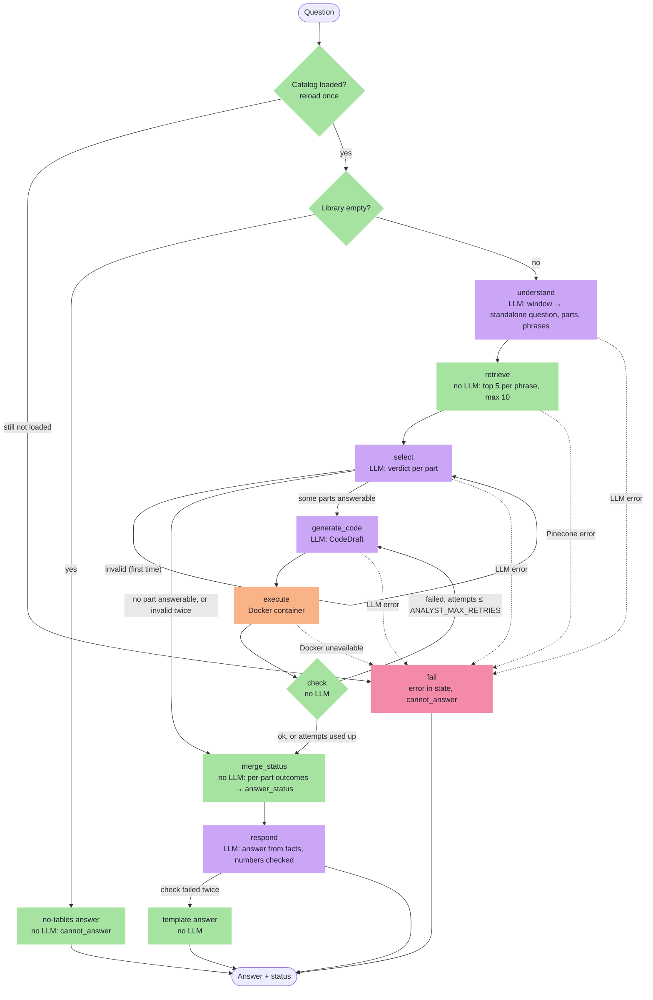

# Spec 02 — Analyst agent

- **Version:** 0.4
- **Last updated:** 2026-10-11
- **Status:** Reviewed (`/review-spec` round 2: READY) — next `/write-spec-plan`
- **Owner:** Federico Viera
- **Parents:** `specs/00-foundation-frozen.md` (spec 00 capsule) and `specs/01-ingestion.md` (v0.7;
  its §7 interfaces are the contract this spec consumes). Parent identifiers are cited, never
  renumbered; this spec uses the 2xx range (FR-201, BR-201, NFR-201, VC-201, A-201, OQ-201).
- **Changelog:** v0.4 — in the UI, Question parts are labelled "Question 1", "Question 2" (D-110):
  FR-235. v0.3 — `/review-spec` round 1 fixes (D-104): empty library is a normal answer
  (FR-202), catalog reload (FR-246), readable sandbox folder (FR-217), `select` size caps (FR-209,
  NFR-205), wording of FR-201, FR-203, FR-212, FR-236, A-206. v0.2 — OQ-201 resolved (D-103): answers in the question's language, search phrases
  in English (FR-204, FR-227); `docker==7.1.0` pinned (A-201). v0.1 — first draft from the spec 02 discovery (D-085 … D-101).
- **Decisions:** root `DECISIONS.md` D-085 … D-101, D-103, D-104, D-110 (plus D-094 / D-095, which also amended spec 01).
  Spec-local decisions made during planning and implementation go to
  `specs/02-analyst-plan-artifacts/DECISIONS.md` as `S02-D-NNN` (D-004).
- **Glossary:** `CONTEXT.md` (Analysis run, Question part, Candidate table, Selected table, Answer
  status, Table, Table metadata, Table preview, Table store, Index record, Document).
- **Supersedes in spec 00:** FR-022 and VC-027's placeholder reply ("answering arrives in spec 02")
  are replaced by FR-201; the spec-02 half of FR-023a / VC-028a (spec 01 FR-104) is replaced by
  FR-201's run. The chat-model picker (FR-024a) stays as built and does not affect the agents
  (D-091).

## 1. Purpose

Octi answers questions about tables found in PDFs (assignment §1). Spec 01 turns PDFs into a
catalog of Tables; this spec delivers the Analyst agent — a LangGraph `StateGraph` that takes a
question in the chat, finds the Tables it needs, writes Python that computes the answer, runs that
code isolated in a Docker container, corrects itself when the code fails, and answers with
`answered`, `partial` or `cannot_answer`, a status decided by the agent's own logic and stored in
its state. It benefits the app user (numeric answers they can check: code, tables and output on
screen), and the graders (assignment §6, the largest grade slice at 30 %, plus the hard
requirements on isolated execution and on answerability).

## 2. Scope

### In
- Analyst graph (D-100): empty-library check, `understand`, `retrieve`, `select`, `generate_code`,
  `execute`, `check`, `merge_status`, `respond`, `fail`.
- Conversation window of 4 turns with query rewriting into a standalone question (D-097).
- Retrieval over spec 01's Index records (D-087); table selection with per-part verdicts (D-088)
  under the answerability rules (D-098).
- Code generation with a trusted prelude (D-090); execution in a Docker container (D-085, D-086);
  the self-correction loop (D-092); the per-part status merge (D-089); the final answer with a
  number check (D-093).
- Failure handling with one `fail` node and no backend names in user messages (D-094).
- UI: live status, the answer message with its folded evidence (D-096).
- LangSmith labels (D-099); settings `ANALYST_MAX_RETRIES`, `SANDBOX_TIMEOUT_SECONDS` (D-092, D-086).
- The sandbox image (`sandbox/Dockerfile`), Docker in the startup check, the service-check script
  and the README (D-086, D-094).
- Tests (D-101).

### Out
- Human-in-the-loop on table selection, charts, automated evals (spec 03 bonus).
- The evaluation report and the test questions (spec 03).
- Restricting a question to one Document; a similarity threshold (D-087).
- Changing the chat-model picker (D-091: it stays; the agents use `LLM_MODEL`).
- A link to LangSmith in the UI (D-095).
- Memory beyond the current session or beyond the last 4 turns (D-097).
- Persisting an Analysis run across browser sessions.

## 3. Actors

| Actor | Description | Permissions |
|---|---|---|
| App user | Asks questions in the chat, reads answers and their evidence | Type questions, open folded sections; never sees configuration, secrets, backend names or raw errors |
| Analyst agent | The LangGraph graph of this spec | Reads the catalog and the Table store; starts sandbox containers; writes nothing to Pinecone or the Table store |
| Sandbox container | Runs one generated script | Reads only the copied Selected tables and the script; no network, no host files, no secrets |
| Student / developer | Builds the sandbox image, runs live checks | Full access; owns `.env` and Docker |
| External services | LiteLLM proxy, Pinecone, LangSmith, the local Docker daemon | Receive only the calls Octi makes |

## 4. Functional Requirements

### Starting a run
- **FR-201 (Must)** — Given the user submits text in the composer, When it is sent, Then an Analysis
  run starts for it and its message replaces spec 00's placeholder reply (FR-022). With a PDF in
  the same message, the Ingestion run happens first and the Analysis run follows it (spec 01
  FR-104); when that ingestion is cancelled or fails, the question still runs against the current
  catalog (D-104). One run at a time: while it streams the composer and the sidebar buttons are
  disabled (as spec 01 FR-161).
- **FR-202 (Must)** — Given the catalog is loaded and holds no Table, When a question is sent, Then a
  no-LLM node answers "There are no tables in the library yet. Attach a PDF with +." with status
  `cannot_answer`; it is a normal answer (badge and text), not the error box (D-094, D-104).
- **FR-246 (Must)** — Given the catalog is not loaded (spec 01 FR-163), When a question is sent, Then
  the catalog is loaded again before the empty-library check; if that fails, the run goes to `fail`
  with kind `vector_store` (FR-230) (D-104).
- **FR-203 (Must)** — Given earlier turns in the conversation, Then the `understand` node receives
  the last 4 turns (a turn = one question and its Analysis answer text; ingestion messages are not
  turns; no tables, code or values); New chat empties them (D-097, D-104).

### Understanding (`understand`)
- **FR-204 (Must)** — `understand` makes one LLM call with `LLM_MODEL` and structured output
  `QueryPlan` (§7): a `standalone_question`, the Question parts (each with its entities, metrics,
  periods and operations), and 1–3 search phrases, one per kind of data needed, written in English to
  match the Table metadata (D-087, D-097, D-103).
- **FR-205 (Must)** — The `understand` prompt states literally "The latest user message wins. Use
  earlier turns only to fill in what it leaves out." A question that is already standalone is kept
  as written (D-097).
- **FR-206 (Must)** — Every later step uses only the `standalone_question` and the plan; the status
  box shows "Understood as: <standalone question>" (D-097).

### Retrieving (`retrieve`)
- **FR-207 (Must)** — `retrieve` embeds each search phrase with spec 00's `make_embeddings`, queries
  Pinecone (namespace `PINECONE_NAMESPACE`) for the 5 closest Index records per phrase, merges them by
  `table_id` keeping the best score, and keeps at most 10 Candidate tables, best first; no LLM call,
  no similarity threshold (D-087).
- **FR-208 (Must)** — Each Candidate table carries its Table metadata and Table preview from its
  Index record (spec 01 §7 `CatalogEntry`); no Table store read happens before selection.

### Selecting (`select`)
- **FR-209 (Must)** — `select` makes one LLM call with structured output `TableSelection` (§7) whose
  input is the standalone question, the Question parts and, per Candidate table, its `table_id`,
  name, description, `columns_info`, row headers, Document, pages and Table preview (D-088). Each
  candidate block is capped at 3,500 characters: name and description; at most the first 40
  columns as `name (unit, dtype)` with their descriptions cut to 60 characters; the first 20 row
  headers; the stored preview (D-104).
- **FR-210 (Must)** — The output has one entry per Question part: `table_ids`, a `verdict`
  (`answerable`, `missing_data` or `ambiguous`) and `missing` (what is missing and what the related
  Table does contain), required unless the verdict is `answerable` (D-088).
- **FR-211 (Must)** — The `select` prompt contains the answerability rules block of §7 verbatim and
  two few-shot `user`/`assistant` pairs: a missing comparison value (`missing_data`, naming what the
  table holds) and an ambiguous column (`ambiguous`, naming both columns) (D-098).
- **FR-212 (Must)** — Code checks the selection: every `table_id` is a Candidate table, there is
  exactly one entry per Question part, and `missing` is not empty when required. A failing selection
  gets one retry with one feedback sentence per problem; after a second failure every Question part
  is missing with the reason "I couldn't decide which tables to use.", the run goes to
  `merge_status` (status `cannot_answer`) and `respond` writes the answer (D-088, D-104).
- **FR-213 (Must)** — Given no Question part is `answerable`, Then the run goes to `merge_status`
  without generating or running code (D-088).

### Generating code (`generate_code`)
- **FR-214 (Must)** — `generate_code` makes one LLM call with structured output `CodeDraft` (`code`,
  and `approach`: 1–2 sentences on the calculation, including every conversion done) (D-090).
- **FR-215 (Must)** — Its prompt follows Class 4 (Markdown headers; Role, Rules, Data, Output,
  Retries, Reminder) and contains: the answerability rules block of §7 verbatim; per Selected table
  its alias, name, description, exact column names with dtype and unit, row headers and first 5
  rows; the `answerable` Question parts only; the rule to use only `tables[...]`, pandas, numpy and
  the standard library; the rule to `emit` a part as `missing` with a reason when needed rows,
  columns or values are absent; and one few-shot pair whose question has one part `missing`
  (D-090, D-098).
- **FR-216 (Must)** — On a retry the prompt also carries the previous attempt's code and that
  attempt's feedback (FR-221), not earlier attempts (D-092).

### Executing (`execute`)
- **FR-217 (Must)** — `execute` writes `main.py` = Octi's trusted prelude (§7) followed by the
  generated code, and copies only the Selected tables' Parquet files (spec 01 `read_table` storage)
  into a new temporary folder, which is mounted read-only at `/work`. The folder is readable by the
  container user (folder mode 0755, files 0644) (D-086, D-104).
- **FR-218 (Must)** — The container runs from image `octi-sandbox:1` with: no network; a read-only
  root filesystem with a 64 MB `/tmp`; 512 MB of memory and no extra swap; 1 CPU; at most 64
  processes; all capabilities dropped; no new privileges; user 10001; no environment variables from
  the host; removed when the run ends. The temporary folder is deleted afterwards (D-086).
- **FR-219 (Must)** — Given a run lasts longer than `SANDBOX_TIMEOUT_SECONDS`, Then the container is
  killed and the attempt fails as a timeout (D-086).
- **FR-220 (Must)** — The exit code, stdout and stderr are captured, each output cut to 64 KB
  (D-086).

### Checking and retrying (`check`)
- **FR-221 (Must)** — `check` (no LLM) classifies the attempt; a failure and its feedback is one of
  (D-092):
  1. exit code ≠ 0 → the last 2,000 characters of stderr;
  2. timeout → "The code ran longer than N s. Avoid loops over rows; use pandas operations.";
  3. no valid last JSON line from `emit` → "The code must end by calling `emit(parts)` exactly
     once." plus the schema error;
  4. emitted parts different from the `answerable` Question parts → which parts are missing or
     extra.
  A part emitted as `missing` is not a failure.
- **FR-222 (Must)** — Given a failure after attempt *k*, When *k* ≤ `ANALYST_MAX_RETRIES`, Then
  `generate_code` runs again (FR-216); When *k* = `ANALYST_MAX_RETRIES` + 1, Then every `answerable`
  part becomes failed ("I couldn't compute this part.") and the run goes to `merge_status`
  (D-092).
- **FR-223 (Must)** — Every attempt (code, stdout, stderr, exit code, failure kind) is kept in the
  state for the UI (D-092).

### Status (`merge_status`)
- **FR-224 (Must)** — Each Question part's outcome is computed by code (D-089): `answered` when the
  selection said `answerable` and the code emitted `answered`; otherwise missing (with the code's
  or the selection's reason) or failed (FR-222).
- **FR-225 (Must)** — The Answer status is `answered` when every part is answered, `partial` when
  some are, `cannot_answer` when none is; it is stored in the state as `answer_status` with
  `part_outcomes` (D-089).
- **FR-226 (Must)** — The prelude's `emit` turns every `answered` value that is NaN, None, infinite,
  or neither a number nor text into `missing` with "the computed value is empty (missing data in
  the table)" (D-090).

### Answering (`respond`)
- **FR-227 (Must)** — `respond` makes one LLM call with structured output `FinalAnswer` (`text`)
  from facts only: the standalone question, the Question parts, the part outcomes with values or
  reasons, `approach`, the Selected tables' names, Documents and pages, and the read-only Answer
  status. The text has 2–6 sentences: results first, then the method (stating every conversion),
  then the sources ("from <Table name>, <file>, page N"), then each unanswered part with its reason;
  it is written in the language of the user's question (D-093, D-103).
- **FR-228 (Must)** — Given the status is `cannot_answer`, Then no value is passed to `respond`
  (D-089).
- **FR-229 (Must)** — Code checks that every number in `text` is a computed value (allowing
  thousands separators, rounding to the shown precision and scale words), a year or a page from the
  facts, or a Question part number; another number gets one retry with "The number X is not in the
  results."; a second failure, or a failing LLM call, uses a template answer built by code from the
  same facts (D-093).

### Failures
- **FR-230 (Must)** — Given an LLM failure (after the client's retries) in `understand`, `select`,
  `generate_code`, or a Pinecone failure in `retrieve`, Then the run goes to `fail`, which stores
  `error` (`kind`: `llm` / `vector_store` / `sandbox`, and a safe message) and sets
  `cannot_answer`; the chat shows an error box with "Something went wrong on my side and I couldn't
  answer. Please try again in a moment." (D-094).
- **FR-231 (Must)** — Given Docker fails during `execute` after startup (daemon gone, image missing),
  Then the run goes to `fail` with kind `sandbox` and the same generic message (D-094).
- **FR-232 (Must)** — Given the app starts, Then the startup check also checks Docker cheaply (daemon
  reachable, image `octi-sandbox:1` present); when it fails, the Octi error screen is shown (spec
  00 FR-027a pattern) naming Docker, what to do (start Docker; build the image with the README
  command) and the README section (D-094).
- **FR-233 (Must)** — The service-check script reports one more line: Docker reachable and the image
  present (`OK` / `FAIL: <reason>`) (D-086).

### The run in the chat
- **FR-234 (Must)** — While the run works, one assistant message shows a live status box with one
  line per node: "Understood as: …", "Searching the library (N searches)…", "Selected N tables",
  "Running the calculation (attempt K of M)…", "Writing the answer…"; it collapses when the run
  ends (D-096).
- **FR-235 (Must)** — The finished message shows, in order: the Answer status badge (from state;
  answered, partial and cannot_answer with distinct colors), the answer text, one "Missing:" line
  (labelled "Question N", the UI's name for a Question part, D-110)
  per unanswered Question part, then folded sections: **Tables used** (spec 01's Table card per
  Selected table, with **Show data** loading the full Table from the Table store only when opened),
  **Code** (the last attempt), **Output** (stdout and the emitted result), **Attempts** (each failed
  attempt's code and failure) (D-096).
- **FR-236 (Must)** — Given the run ended at selection (no code ran), Then the message shows the badge,
  the text, the "Missing:" lines and **Tables considered** (the Candidate tables named in the
  selection; when none is named, the 3 best Candidate tables), and no Code, Output or Attempts
  sections (D-096, D-104).
- **FR-237 (Must)** — Given the run ended in `fail`, Then the message shows the error box of FR-230
  instead of the badge and sections (D-094).
- **FR-238 (Must)** — The whole message stays in the conversation history and is redrawn on every
  rerun (spec 00 BR-008).

### Tracing
- **FR-239 (Must)** — Every Analysis run is traced with run name `Analysis: <first 60 characters of
  the question>`, tag `analysis`, metadata `llm_model`, `max_retries`, `thread_id`, `window_turns`
  at the start, and `answer_status`, `parts_total`, `parts_answered`, `attempts`,
  `selected_tables`, `error_kind` added when it ends; every node is a span; it is traced whenever
  `Settings` has tracing on (as spec 01 FR-154) (D-099).
- **FR-240 (Must)** — The `execute` span records the exit code, whether it timed out and the sizes of
  stdout and stderr, not their content (D-099).

### Settings, image, docs and tests
- **FR-241 (Must)** — `Settings` parses `ANALYST_MAX_RETRIES` (integer 0–5, default 2) and
  `SANDBOX_TIMEOUT_SECONDS` (integer 5–120, default 30); other values raise `InvalidSettingsError`
  naming them; `.env.example` documents both (D-092, D-086).
- **FR-242 (Must)** — `sandbox/Dockerfile` builds `octi-sandbox:1` from `python:3.13-slim` with the
  app's pandas and pyarrow pins and a non-root user 10001; the README gives the build command
  (D-086).
- **FR-243 (Must)** — The README gains: Docker as a prerequisite and the image build step in Getting
  started; the Analyst's design decisions (each "X works this way because Y": Docker isolation and
  its flags, retrieval, selection and answerability rules, status merge, the number check, the
  conversation window); the Analyst graph as a Mermaid diagram exported from the compiled graph;
  known limitations (code that silently uses a wrong row; a 4-turn window can carry over a wrong
  entity; the picker does not change the model) (assignment §9, D-043 style).
- **FR-244 (Must)** — The default test run covers the layers of D-101 offline: the prelude run
  in-process, graph routes with a scripted stub LLM, spec 01's fake Pinecone and a stub sandbox
  runner, and AppTest UI tests (spec 00 FR-034).
- **FR-245 (Must)** — Given the `live` marker is selected, Then one test proves isolation with real
  containers (a normal run succeeds; reading the secrets file, a network call, an endless loop and a
  fork bomb are each stopped) and one test asks a question about `acme-annual-report-2023.pdf` and
  asserts the status and shape of the answer, never its wording (D-101).

## 5. Business Rules

- **BR-201** — The Analyst uses only data from indexed Tables: no general knowledge, outside
  sources or estimates. *Rationale:* assignment §6.4. *Exceptions:* conversions that need no
  outside data (rules block, rule 3).
- **BR-202** — The Answer status is decided by code from the selection and the code's result and
  stored in the state; no LLM output can change it. *Rationale:* §6.4, CLAUDE.md. *Exceptions:*
  none.
- **BR-203** — A `cannot_answer` answer shows no numeric result. *Rationale:* §6.4.
  *Exceptions:* years, pages and part numbers that describe what is missing.
- **BR-204** — Generated code runs only inside the sandbox container, never in the app's process.
  *Rationale:* assignment §6.2.5 and §8. *Exceptions:* none (offline tests run Octi's own prelude
  in-process, never generated code).
- **BR-205** — The container sees only the copied Selected tables and the script: no network, no
  host files, no environment variables from the host, no secrets. *Rationale:* §6.2.5; the
  playground sandbox lesson's secrets-file read. *Exceptions:* none.
- **BR-206** — Messages to the user never name a backend service or tool (as spec 01 BR-106).
  *Rationale:* D-094. *Exceptions:* the developer-facing error screen and service-check script.
- **BR-207** — No secret value appears in prompts, graph state, traces or the container.
  *Rationale:* assignment §11 (extends spec 00 BR-003). *Exceptions:* none.
- **BR-208** — The graph state never holds a full DataFrame; Tables enter the state only as metadata
  and previews. *Rationale:* traces and checkpoints stay small (as spec 01 BR-111).
  *Exceptions:* none.
- **BR-209** — The LLM never introduces a `table_id`: every id used comes from the Candidate tables.
  *Rationale:* course RAG lab ("never invent ids"). *Exceptions:* none.
- **BR-210** — Every Analysis run ends with exactly one Answer status; none stays "running".
  *Rationale:* §6.4; playground validation-loop lesson. *Exceptions:* none.
- **BR-211** — The latest user message wins over the conversation window. *Rationale:* Class 7.
  *Exceptions:* none.
- **BR-212** — Every LLM call of the Analyst uses `LLM_MODEL` (D-091). *Rationale:* comparable runs.
  *Exceptions:* none.

## 6. Non-Functional Requirements

- **NFR-201 (Performance)** — With live services and the image built, a one-table question about
  the ACME sample is answered in under 60 s (measured once by the student).
- **NFR-202 (Performance)** — A sandbox container starts and finishes a trivial script in under 3 s
  with the image already built (measured once by the student).
- **NFR-203 (Performance)** — The offline suite stays under 60 s (spec 01 NFR-103).
- **NFR-204 (Offline)** — The default test run opens zero network connections and needs no Docker.
- **NFR-205 (Cost)** — The `select` prompt with 10 Candidate tables at their maximum size totals at
  most 40,000 characters (measured offline, as spec 01 NFR-104; D-104).
- **NFR-206 (UI)** — Analysis messages render without horizontal page scroll at 1280×800 and 375 px;
  code and wide tables scroll inside their own boxes.

## 7. Data & Interfaces

### Environment variables (addition to spec 00 §7 and spec 01 §7)

| Variable | Type after parsing | Required | Default | Rule |
|---|---|---|---|---|
| `ANALYST_MAX_RETRIES` | int 0–5 | no | 2 | code attempts = value + 1 (D-092) |
| `SANDBOX_TIMEOUT_SECONDS` | int 5–120 | no | 30 | wall-clock limit per container run (D-086) |

### Consumed from spec 01 (§7)
`load_catalog(settings) -> list[CatalogEntry]`, `CatalogEntry`, `read_table(table_id) -> DataFrame`,
the Index record fields (`columns_info`, `row_headers`, `preview`, `pages`, `source_file`), and
`data/tables/<table_id>.parquet`.

### Pydantic models

```python
class QuestionPart(BaseModel):
    number: int                      # 1-based
    text: str                        # the sub-question
    entities: list[str]
    metrics: list[str]
    periods: list[str]
    operations: list[str]

class QueryPlan(BaseModel):          # understand's structured output
    standalone_question: str
    parts: list[QuestionPart]        # at least 1
    search_phrases: list[str]        # 1–3

class PartSelection(BaseModel):
    part: int
    table_ids: list[str]
    verdict: Literal["answerable", "missing_data", "ambiguous"]
    missing: str                     # required unless verdict == "answerable"

class TableSelection(BaseModel):     # select's structured output
    parts: list[PartSelection]

class CodeDraft(BaseModel):          # generate_code's structured output
    code: str
    approach: str                    # 1–2 sentences, conversions included

class EmittedPart(BaseModel):        # one entry of the emit(...) JSON line
    part: int
    status: Literal["answered", "missing"]
    values: dict[str, float | int | str] = {}
    missing: str = ""

class PartOutcome(BaseModel):        # merge_status's per-part result
    part: int
    outcome: Literal["answered", "missing", "failed"]
    values: dict[str, float | int | str] = {}
    reason: str = ""

class FinalAnswer(BaseModel):        # respond's structured output
    text: str                        # 2–6 sentences
```

### Analyst state (fields)
`question`, `window` (≤ 4 turns), `plan` (`QueryPlan`), `candidates` (≤ 10 `CatalogEntry`),
`selection` (`TableSelection`), `selection_attempts`, `code_attempts`, `last_failure`,
`attempts_history` (every attempt: code, stdout, stderr, exit code, failure kind), `part_outcomes`,
`answer_status`, `answer` (`FinalAnswer` text), `error` (`kind`: `llm` / `vector_store` / `sandbox`,
safe message) or none. No DataFrame (BR-208).

### Analyst graph (D-100)


Purple: LLM call. Green: plain code. Peach: Docker. Red: failure exit. Dotted: infrastructure
failures.

### The prelude (written by Octi at the top of every `main.py`)
- Imports `json`, `math`, `pandas as pd`, `numpy as np`.
- `tables = {"<alias>": pd.read_parquet("/work/<table_id>.parquet"), …}` for the Selected tables;
  aliases are short, unique snake_case names derived from the Table names.
- `emit(parts)`: validates nothing about meaning, applies FR-226's safety net, prints exactly one
  JSON line `{"parts": [...]}` as the last line of stdout. Generated code calls it once.

### Sandbox container (D-086)
- Image `octi-sandbox:1` from `sandbox/Dockerfile` (`python:3.13-slim`, `pandas==3.0.6`,
  `pyarrow==25.0.1`, user 10001).
- Run settings (Docker SDK): network disabled; read-only root filesystem; tmpfs `/tmp` 64 MB;
  memory 512 MB and memory+swap 512 MB; 1 CPU; pids limit 64; cap-drop ALL;
  `no-new-privileges`; user 10001; empty environment; volume `<temp dir>:/work:ro`; command
  `python /work/main.py`; removed after the run.

### Answerability rules block (D-098) — verbatim in the `select` and `generate_code` prompts

```markdown
# Answerability rules
Use only the data in the tables given. Apply these rules to every part of the question.
1. A period or entity the tables do not contain is missing. Report it as missing. Do not use the
   nearest period, interpolate or extrapolate.
2. A conversion that needs outside data (exchange rates, inflation, population) is missing, unless
   one of the tables given provides that data.
3. Conversions that need no outside data are allowed: scale (thousands to millions), percent to
   fraction and back, and summing all the months of a year. Do them and state them.
4. A comparison value the tables do not contain (for example a national average) is missing. Do
   not replace it with a value computed from other rows, unless the question defines it that way.
5. When the meaning or unit of a column is unclear and the choice changes the result (nominal or
   real values, two candidate columns, a unit "not stated" that the answer depends on), the part is
   ambiguous. Name the options. A value whose unit is "not stated" can still be reported, saying so.
6. Monthly data with missing months cannot be summed into a year. The part is missing.
7. Forecasts and opinions are missing: they are not in the data.
```

### Errors (addition to the tree; spec 00 BR-011)

```
ExternalServiceError
└── SandboxError                        # .service = "Docker"
    └── SandboxUnavailableError 🍃      # daemon unreachable or image missing (FR-231, FR-232)
```
A timeout or a failing script is an attempt outcome, not an error.

### Files
- `agents/analyst/` — `graph.py`, `state.py`, `nodes.py`, `schemas.py`, `prompts.py` (the layout
  the assignment shows; helpers grouped as in D-084 if they grow).
- `services/sandbox.py` — Docker client factory, run, startup check, error translation (D-034).
- `sandbox/Dockerfile` — the sandbox image.

### Code constants (not configuration)
- Window: 4 turns. Search phrases: at most 3. Top-k per phrase: 5. Candidate tables: at most 10.
- Output cap: 64 KB each for stdout and stderr; stderr tail in feedback: 2,000 characters.
- Container: 512 MB, 1 CPU, 64 processes, 64 MB `/tmp`, user 10001, image tag `octi-sandbox:1`.
- Selection retries: 1. Number-check retries: 1. Answer length: 2–6 sentences.
- `select` caps: 3,500 characters per candidate, 40 columns, 60-character column descriptions, 20 row
  headers. Sandbox folder modes: 0755 / 0644. Fallback folder: `data/sandbox_runs/` (git-ignored).

## 8. Verification Criteria

Starting a run (AppTest with a stub runner)
- VC-201 (FR-201): send "hello" → an Analysis run starts and its message replaces the old spec-02
  placeholder; while it streams the composer and sidebar buttons are disabled; text plus a PDF whose
  ingestion is cancelled → the Analysis run still starts.
- VC-202 (FR-202): empty catalog → the FR-202 sentence as a normal answer (badge, no error box),
  status `cannot_answer`, `error` none, the stub LLM records zero calls.
- VC-248 (FR-246): catalog not loaded and Pinecone still failing → `fail` with kind `vector_store` and
  the generic message, not the no-tables answer; Pinecone recovered → the catalog loads and the run
  continues.
- VC-203 (FR-203): 6 earlier Analysis turns and 2 ingestion messages → `understand` receives the last
  4 Analysis turns, each with question and answer text only; after New chat it receives none.

Understanding and retrieval (scripted stub LLM, fake Pinecone)
- VC-204 (FR-204, BR-212): the stub records `LLM_MODEL` and structured output `QueryPlan`, even when
  the picker shows another model.
- VC-205 (FR-205, BR-211): the `understand` system prompt contains the "latest user message wins"
  sentence verbatim.
- VC-206 (FR-206): "And in 2022?" after an ACME revenue turn → later nodes receive the stub's
  standalone question; the status box shows "Understood as: …".
- VC-207 (FR-207): 2 phrases, each returning 5 records with 3 shared ids → 7 Candidate tables, best
  score kept per id; 3 phrases × 5 distinct → 10 kept, best first; zero LLM calls in `retrieve`.
- VC-208 (FR-208): Candidate tables carry metadata and preview; the Table store records zero reads
  before `select`.

Selection
- VC-209 (FR-209, FR-210): the `select` input lists every candidate's fields of FR-209; a stub answer
  with verdicts for 2 parts is parsed into `TableSelection`.
- VC-210 (FR-211): the `select` prompt contains §7's rules block verbatim and the two few-shot pairs.
- VC-211 (FR-212, BR-209): a stub answer with an unknown id, a missing part and an empty `missing` →
  one retry carrying three feedback sentences; a second invalid answer → `cannot_answer` with "I
  couldn't decide which tables to use." as every part's reason, status `cannot_answer`, and `respond`
  called with those facts.
- VC-212 (FR-213): all parts `missing_data` → no `generate_code` call, no sandbox run, status
  `cannot_answer`.

Code generation, execution, retries (stub sandbox runner unless marked live)
- VC-213 (FR-214, FR-215): the `generate_code` prompt contains the rules block, each Selected table's
  alias and exact columns with dtype and unit, only the answerable parts, and the few-shot pair.
- VC-214 (FR-216): the third attempt's prompt contains attempt 2's code and feedback and not attempt
  1's.
- VC-215 (FR-217, BR-205): the temporary folder handed to the runner holds exactly the Selected
  tables' Parquet files and `main.py`, `main.py` starts with the prelude, the folder's mode is 0755
  and every file's mode is 0644.
- VC-216 (FR-218, BR-204, BR-205): the container settings passed to the Docker SDK (inspected on a
  fake client) match §7 exactly, including an empty environment.
- VC-217 (FR-219, FR-221): a runner reporting a timeout → feedback names N seconds; the container is
  killed (fake client records it).
- VC-218 (FR-220): 1 MB of stdout → 64 KB kept.
- VC-219 (FR-221): each failure kind (exit ≠ 0, timeout, no `emit` line, wrong parts) → the FR-221
  feedback; a part emitted `missing` → no retry.
- VC-220 (FR-222, BR-210): `ANALYST_MAX_RETRIES=2`, three failures → three attempts, the answerable
  parts become failed, the run ends with a status; `=0` → one attempt.
- VC-221 (FR-223): two attempts → `attempts_history` holds both with code, outputs and failure kind.

Status and answer
- VC-222 (FR-224, FR-225, BR-202): the four rows of the merge table (D-089) give the expected part
  outcomes; all answered → `answered`; one of two → `partial`; none → `cannot_answer`; a stub
  `respond` text claiming another status leaves `answer_status` unchanged.
- VC-223 (FR-226): the prelude run in-process with `emit` of NaN, None, inf and an object →
  each part becomes `missing` with the FR-226 reason; a valid value stays `answered`; exactly one
  JSON line is printed last.
- VC-224 (FR-227): the `respond` input holds the FR-227 facts and its prompt asks for the language of
  the question; a stub text is shown as the answer; the `understand` prompt asks for English search
  phrases.
- VC-225 (FR-228, BR-203): status `cannot_answer` → the `respond` input contains no value.
- VC-226 (FR-229): a stub text with "1,288.7" for a computed 1288.7 passes; a text with an invented
  "1,300" → one retry with the FR-229 feedback, then the template answer; a failing `respond` LLM →
  the template answer.

Failures
- VC-227 (FR-230, BR-206): an LLM error in each of `understand`, `select`, `generate_code` and a
  Pinecone error in `retrieve` → `fail`, `error.kind` set, status `cannot_answer`, the generic
  message, and none of "LiteLLM", "Pinecone", "Docker", "proxy" in the UI text.
- VC-228 (FR-231): the fake Docker client raising "daemon unreachable" during `execute` → `fail` with
  kind `sandbox` and the generic message.
- VC-229 (FR-232): the startup check with a fake Docker client that is unreachable, and separately
  one without the image → the Octi error screen naming Docker, the build command and the README
  section; the shell is not rendered.
- VC-230 (FR-233): the service-check script with a healthy and a failing fake Docker client → a
  Docker `OK` line, then a `FAIL` line; the other checks still run.

UI (AppTest with a stub runner)
- VC-231 (FR-234): a stubbed run → the status lines appear in node order, including "Understood as".
- VC-232 (FR-235): an answered run → badge, text, then the four folded sections in order; opening
  **Show data** reads the Table store once; before that, zero reads.
- VC-233 (FR-236): a run ended at selection → badge, text, "Missing:" lines, **Tables considered**;
  no Code, Output or Attempts sections; a selection naming no table → the 3 best Candidate tables
  listed.
- VC-234 (FR-237): a run ended in `fail` → the error box and no badge or sections.
- VC-235 (FR-238): after the run, send another question → the first message is still in the
  history.

Tracing, settings, secrets
- VC-236 (FR-239): a stubbed run → the config holds the run name, tag and start metadata; the end
  metadata keys are recorded when the run ends (inspected offline).
- VC-237 (FR-240): the `execute` span holds exit code, timeout flag and sizes, and no stdout text.
- VC-238 (FR-241): unset → 2 and 30; `6` / `4` / `121` / `x` → `InvalidSettingsError` naming the
  variable; `.env.example` contains both.
- VC-239 (BR-207): `Settings` with fake secrets → none of them in any recorded prompt, the final
  state, the trace config, or the container settings.
- VC-240 (BR-208): no state update during a run holds a `DataFrame`.
- VC-241 (BR-201): the `understand`, `select`, `generate_code` and `respond` prompts each instruct
  the use of only the given data (verbatim sentences checked).

Image, docs, tests
- VC-242 (FR-242): `sandbox/Dockerfile` uses `python:3.13-slim`, the app's pandas and pyarrow pins
  and user 10001; the README contains the build command.
- VC-243 (FR-243): the README has the Docker prerequisite and build step, the Analyst design
  decisions, a Mermaid block naming every Analyst node, and the known limitations.
- VC-244 (FR-244, NFR-203, NFR-204): default `pytest` → all pass, under 60 s, zero network
  connections, no Docker needed.
- VC-245 (FR-245, BR-204, BR-205): `pytest -m live` (by the student, image built) → the normal run
  succeeds; the secrets-file read, the network call, the endless loop and the fork bomb are each
  stopped; the ACME question ends `answered` with a numeric value and the expected `table_id`.
- VC-246 (NFR-205): 10 candidate tables at their maximum metadata size → each block ≤ 3,500
  characters and the whole `select` prompt ≤ 40,000 characters.
- VC-247 (NFR-201, NFR-202, NFR-206): manual check by the student: a one-table ACME question answers
  in under 60 s; a trivial container run finishes in under 3 s; no horizontal page scroll at
  1280×800 and 375 px.

## 9. Open Questions

None (OQ-201 resolved by D-103).

## 10. Assumptions

- **A-201** — `requirements.txt` pins `docker==7.1.0` (the Docker Python SDK); the student installs it
  with `pip install -r requirements.txt` before implementation starts.
- **A-202** — Docker is available to the student (Docker Desktop with WSL integration on Windows,
  Docker Desktop on macOS), and the student builds `octi-sandbox:1` once.
- **A-203** — The Docker SDK exposes every setting of §7 (network disabled, read-only root, tmpfs,
  memory and swap limits, CPU, pids limit, capabilities, security options, user, volumes).
- **A-204** — LangSmith accepts metadata added to a run when it ends (FR-239); if not, the end
  metadata is attached to the final node's span and the plan records it as an S02-D decision.
- **A-206** — Docker can mount the system temporary folder (default file sharing in Docker Desktop on
  macOS and with WSL integration); where it cannot, the folder is created under the git-ignored
  `data/sandbox_runs/` instead (D-104).
- **A-205** — Spec 01's §7 interfaces (v0.7) hold when spec 02 is implemented; any change made
  during spec 01's implementation is logged as an S01-D entry and folded in here.
