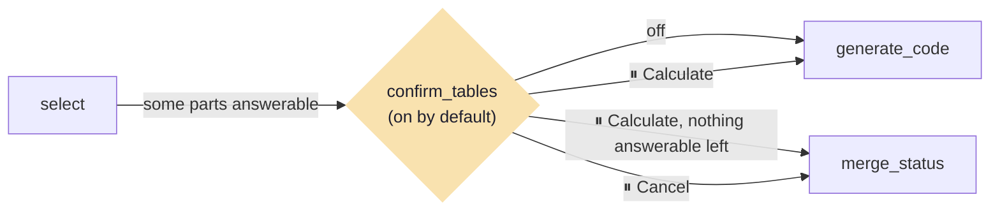
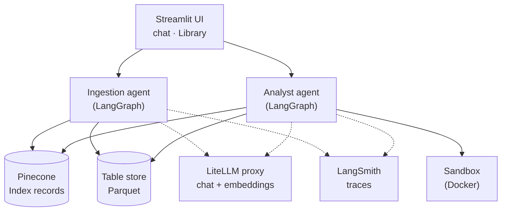

# Spec 03 — Evaluation, docs and bonus

- **Version:** 0.2
- **Last updated:** 2026-10-12
- **Status:** Reviewed (`/review-spec` round 2: READY) — next `/write-spec-plan`
- **Owner:** Federico Viera
- **Parents:** `specs/00-foundation-frozen.md`, `specs/01-ingestion.md` (v0.8: sample PDFs and their
  constants, FR-156), `specs/02-analyst.md` (v0.4: the Analyst graph this spec extends). Parent
  identifiers are cited, never renumbered; this spec uses the 3xx range.
- **Changelog:** v0.2 — `/review-spec` round 1 fixes (D-112): percent matching and zero tolerance
  (FR-308), examples matched by id (FR-305), `confirm_tables` parameter (FR-307, §7), catalog by
  hash (FR-306), scoring's Selected tables (FR-308), who drafts `EVALUATION.md` (FR-327). v0.1 — first draft from the spec 03 discovery (D-106 … D-111).
- **Decisions:** root `DECISIONS.md` D-106 … D-112. Spec-local decisions made during planning and
  implementation go to `specs/03-evaluation-plan-artifacts/DECISIONS.md` as `S03-D-NNN` (D-004).
- **Glossary:** `CONTEXT.md` (Analysis run, Question part, Candidate table, Selected table, Answer
  status, Document, Table).
- **Extends spec 02:** a `confirm_tables` node is added between `select` and `generate_code`
  (FR-315 … FR-321); every other spec 02 requirement stays as written. In the UI a Question part is
  labelled "Question N" (D-110, already in spec 02 v0.4).

## 1. Purpose

Octi must prove that it works and explain itself to the people who grade it (assignment §9, §10).
This spec delivers the test questions with their correct answers, one command that runs and scores
them automatically in LangSmith (the "automated evals" bonus), the evaluation report with three
representative traces, a human-in-the-loop step that lets the user confirm or change the tables the
Analyst picked (the "human-in-the-loop" bonus), and the README pieces that tie specs 00–02 together.
It benefits the examiner (a repeatable evaluation they can run with their own keys, and a report
they can read without running anything) and the student (an honest measure of what Octi gets right).

## 2. Scope

### In
- `eval/questions.yaml`: 10 test questions with expected status, values, Tables and answer (D-107).
- `scripts/run_eval.py`: LangSmith dataset sync, sample-PDF ingestion when missing, one experiment
  over the Analyst graph, three deterministic evaluators, `eval/results.md` (D-108).
- `EVALUATION.md` with three trace screenshots in `docs/eval/` (D-109).
- Human-in-the-loop table confirmation, on by default (D-110).
- README: system overview diagram, Evaluation and Bonus sections, final consistency pass (D-111).
- Tests: offline unit, graph and AppTest tests; one live evaluation run by the student.

### Out
- A demo video (cancelled by the professor; assignment §9.5 waived, D-111).
- Charts and OCR (D-106).
- An LLM-as-judge evaluator (D-108).
- Evaluating ingestion quality with its own dataset (ingestion is exercised through the questions).
- Any change to specs 01 and 02 beyond the `confirm_tables` extension and the README.

## 3. Actors

| Actor | Description | Permissions |
|---|---|---|
| Student | Writes nothing by hand in results; runs the live evaluation; takes the three screenshots | Full access; own `.env`, LangSmith, Pinecone, Docker |
| Examiner | Reads `EVALUATION.md`; may rerun the evaluation with their own `.env` | Same commands as the student, in their own workspace |
| App user | Answers the table-confirmation pause in the chat | Tick and untick Candidate tables, Calculate or Cancel |
| External services | LiteLLM proxy, Pinecone, LangSmith, Docker | Receive only the calls Octi makes |

## 4. Functional Requirements

### Test questions
- **FR-301 (Must)** — `eval/questions.yaml` holds 10 questions; each has `id` (`q01` … `q10`),
  `question`, `category`, `expected_status` (`answered` / `partial` / `cannot_answer`),
  `expected_values` (a list of `{name, value, unit}`; `unit` is optional, `percent` when the value is
  a percentage; empty for `cannot_answer`), `expected_tables` (Table names), and `expected_answer`
  (one or two sentences a human can read) (D-107, D-108).
- **FR-302 (Must)** — The 10 questions cover, one each: (1) single table; (2) single table with an
  allowed scale conversion; (3) a Spanish question on the Spanish PDF; (4) multi-table within ACME
  (R&D share of revenue); (5) multi-table across ACME and the Spanish PDF; (6) no related table →
  `cannot_answer`; (7) missing year → `cannot_answer`; (8) two parts, one missing → `partial`;
  (9) missing comparison value (no national row) → `partial`; (10) gross vs net revenue →
  `cannot_answer` (D-107; assignment §9.3).
- **FR-303 (Must)** — Every `expected_values` entry equals the value computed from the constants of
  `scripts/make_sample_pdfs.py` (spec 01 FR-156), in the entry's unit (a `percent` entry as a
  percentage), within 1 %, checked by an offline test (D-107, D-112).

### The evaluation command
- **FR-304 (Must)** — `python -m scripts.run_eval` builds `Settings` from the environment it runs in
  (the student's or the examiner's `.env`); invalid configuration prints the `InvalidSettingsError`
  names and exits non-zero without calling any service (spec 00 FR-002) (D-108).
- **FR-305 (Must)** — It creates or updates the LangSmith dataset `octi-eval`: one example per
  question, matched by the question's `id` (stored in the example's metadata); a changed question text
  or expected output updates the same example; no duplicates appear across runs (D-108, D-112).
- **FR-306 (Must)** — Before the questions, it ingests each sample PDF whose document hash (spec 01
  D-048) is not in the catalog, through spec 01's graph; a pause in that run is answered
  automatically with **Continue** / **Index N** and reported in the console (D-108).
- **FR-307 (Must)** — It runs every question through spec 02's Analyst graph with
  `run_analysis(..., confirm_tables=False)` (§7), as one LangSmith experiment whose name starts with
  `octi-eval`; each run carries the tag `eval` besides spec 02's labels (FR-239) (D-108).
- **FR-308 (Must)** — Three deterministic evaluators score each run from its final state (D-108):
  1. `status_correct`: `answer_status` equals `expected_status`;
  2. `values_correct`: every expected value matches some value in the run's answered part outcomes —
     within 1 % (or 0.001 absolute when the expected value is 0); with `unit: percent` a computed
     value matches `v` or `v / 100`; not applicable (skipped, shown as "–") when `expected_status` is
     `cannot_answer` (D-112);
  3. `tables_correct`: the Selected tables are the tables of the run's answerable Question parts;
     every expected Table name is among them, and an empty `expected_tables` is correct only when no
     table was selected (D-112).
- **FR-309 (Must)** — A question whose run raises an error is recorded as an error row (all checks
  ✗, the error kind noted) and the other questions still run (D-108).
- **FR-310 (Must)** — It writes `eval/results.md`: a header with the run date (UTC), `LLM_MODEL`, the
  git commit (short SHA, or "unknown") and the experiment name; one row per question with `id`, the
  question, expected and actual status, the three marks (✓ / ✗ / –), retries (code attempts − 1) and
  the run's LangSmith link; totals per evaluator (D-108).
- **FR-311 (Must)** — The command exits 0 when every question was run (whatever the marks), and
  non-zero only when the evaluation itself could not run (configuration, LangSmith or Pinecone
  unreachable) (D-108).

### The evaluation report
- **FR-312 (Must)** — `EVALUATION.md` exists at the repository root, linked from the README, with
  these sections in order: How to run (the command; works with anyone's own keys), Run details
  (copied from `eval/results.md`'s header), Results (the table and totals copied from
  `eval/results.md`), Notes, Representative traces, Limitations (D-109).
- **FR-313 (Must)** — Notes has one entry per ✗ or error in the results, naming the step that failed
  (retrieval, selection, table confirmation, code generation, execution, answerability rule,
  answer) and what happened (D-109).
- **FR-314 (Must)** — Representative traces shows three screenshots stored in `docs/eval/`
  (`answered-multi-table.png`, `partial.png`, `cannot-answer.png`), each with one line saying what it
  shows; the `answered` one is a multi-table question, ideally with at least one retry; public
  LangSmith share links may be added next to them (D-109).

### Human-in-the-loop table confirmation (extends spec 02)
- **FR-315 (Must)** — Given table confirmation is on and at least one Question part is `answerable`
  after `select`, Then a `confirm_tables` node pauses the run with a LangGraph `interrupt` before
  `generate_code`; with confirmation off, or no answerable part, the run continues as in spec 02
  (D-110).
- **FR-316 (Must)** — The pause shows, inside the run's message, "Before I calculate, check the tables
  I picked:" and, per Question part labelled "Question N": its text, its Selected tables as ticked
  boxes and the other Candidate tables as unticked boxes (each with its Document and pages), or, for
  an unanswerable part, its reason; then **Cancel** and **Calculate** (D-110).
- **FR-317 (Must)** — **Calculate** resumes with the ticked tables per part: they replace that part's
  `table_ids`; only Candidate tables can be chosen (BR-209); a part left with no table becomes missing
  with "No table was chosen."; when no part is left answerable, the run goes to `merge_status`
  without code (D-110).
- **FR-318 (Must)** — **Cancel** ends the run with status `cannot_answer` and the reason "Cancelled
  before calculating." for every part; no code runs (D-110).
- **FR-319 (Must)** — A chat toggle "Confirm tables before calculating" is on by default, lasts for the
  browser session, and is read when a run starts (D-110).
- **FR-320 (Must)** — While paused, spec 01 FR-161's rule applies (composer disabled with "Answer the
  question above first.", sidebar enabled) and New chat abandons the run (as spec 01 FR-162); the
  paused and resumed halves share one `thread_id` (in-memory checkpointer) (D-110).
- **FR-321 (Must)** — The status box shows "Waiting for your confirmation" during the pause; the run's
  LangSmith metadata gains `confirmation` (`skipped` / `confirmed` / `changed` / `cancelled`) (D-110).

### README
- **FR-322 (Must)** — The README gains a system overview Mermaid diagram (Streamlit UI → Ingestion and
  Analyst agents → Pinecone, Table store, sandbox; LiteLLM and LangSmith underneath) placed before
  the two graph diagrams of specs 01 and 02 (D-111).
- **FR-323 (Must)** — The README gains an Evaluation section: one paragraph, the command, a link to
  `EVALUATION.md` (D-111).
- **FR-324 (Must)** — The README gains a Bonus section: automated evals and table confirmation, with
  how to try each (D-111).
- **FR-325 (Must)** — Final consistency pass: the Project architecture tree lists `eval/`,
  `docs/eval/`, `EVALUATION.md` and `scripts/run_eval.py`; Credits names the course sources by
  title; no demo-video section exists; `tests/unit/test_readme.py` pins the new sections (D-111).

### Tests
- **FR-326 (Must)** — The default test run covers offline: the YAML schema and category coverage
  (FR-301, FR-302), expected values against the sample-PDF constants (FR-303), the three evaluators
  and error rows on fake states (FR-308, FR-309), the results writer (FR-310), the dataset-sync
  logic with a fake LangSmith client (FR-305), the `confirm_tables` routes with spec 02's stubs
  (FR-315 … FR-318, FR-321), and the confirmation UI with AppTest (FR-316, FR-319, FR-320).
- **FR-327 (Must)** — The student runs `python -m scripts.run_eval` once with real services; the
  final iteration drafts `EVALUATION.md` from that run's `eval/results.md` and the trace details the
  student provides (failing steps, retries); the student reviews it and adds the three screenshots
  (D-112).

## 5. Business Rules

- **BR-301** — Expected values are never typed by hand without a check: each is verified against the
  sample-PDF constants. *Rationale:* D-107. *Exceptions:* none.
- **BR-302** — Evaluators are deterministic code; no LLM grades another LLM. *Rationale:* D-108;
  course failure-demos notebook. *Exceptions:* none.
- **BR-303** — The evaluation runs the same graphs, prompts and settings as the app; the only
  difference is table confirmation turned off. *Rationale:* Class 4 ("test configuration equals
  production"). *Exceptions:* none.
- **BR-304** — The confirmation pause offers only Candidate tables. *Rationale:* spec 02 BR-209.
  *Exceptions:* none.
- **BR-305** — `EVALUATION.md` reports the run it names as it happened: results copied from that
  run's `eval/results.md`, every ✗ explained, nothing improved by hand. *Rationale:* assignment §10
  ("honest reporting"). *Exceptions:* none.
- **BR-306** — Nothing in the evaluation names the student's own workspace, index or keys; it uses the
  `Settings` it runs with. *Rationale:* the examiner reruns it with their own `.env` (D-108).
  *Exceptions:* none.
- **BR-307** — The app's UI never names LangSmith (spec 01 BR-106); the evaluation files and
  `EVALUATION.md` are developer-facing and may. *Rationale:* D-094, D-095, D-108. *Exceptions:* none.

## 6. Non-Functional Requirements

- **NFR-301 (Performance)** — With live services, the evaluation of 10 questions (sample PDFs already
  ingested) completes in under 15 minutes (measured once by the student).
- **NFR-302 (Performance)** — The offline suite stays under 60 s (spec 01 NFR-103).
- **NFR-303 (Offline)** — The default test run opens zero network connections and needs no Docker.
- **NFR-304 (UI)** — The confirmation pause renders without horizontal page scroll at 1280×800 and
  375 px.

## 7. Data & Interfaces

### `eval/questions.yaml`

```yaml
- id: q01
  question: "What was ACME's revenue in 2022?"
  category: single_table
  expected_status: answered
  expected_values:
    - {name: revenue_2022, value: 1322.0}           # optional: unit: percent
  expected_tables: ["Key financial figures"]
  expected_answer: "ACME's revenue in 2022 was USD 1,322.0 million (Key financial figures, page 1)."
```
`category` ∈ `single_table`, `scale_conversion`, `spanish`, `multi_table`, `multi_table_cross_pdf`,
`no_related_table`, `missing_year`, `partial`, `missing_comparison`, `ambiguous`. The values and Table
names above are illustrative; the real ones come from spec 01's sample-PDF constants and extracted
Table names.

### `eval/results.md` (written by the command)
Header lines `Run date`, `Model`, `Commit`, `Experiment`; a table with columns `id`, `Question`,
`Expected`, `Actual`, `Status`, `Values`, `Tables`, `Retries`, `Trace`; a totals line per evaluator.

### `EVALUATION.md` outline
`## How to run` · `## Run details` · `## Results` · `## Notes` · `## Representative traces` ·
`## Limitations`; images `docs/eval/answered-multi-table.png`, `docs/eval/partial.png`,
`docs/eval/cannot-answer.png`.

### Confirmation pause (interrupt payload and resume value)

```python
# payload sent to the UI by confirm_tables
{"parts": [{"number": 1, "text": "...", "answerable": True,
            "selected": ["<table_id>", ...],
            "candidates": [{"table_id": "...", "name": "...", "document": "...", "pages": [3]}],
            "reason": ""}, ...]}
# resume values
Command(resume={"action": "calculate", "tables": {1: ["<table_id>", ...], 2: []}})
Command(resume={"action": "cancel"})
```
State additions to spec 02's `AnalystState`: `confirmation` (`skipped` / `confirmed` / `changed` /
`cancelled`). Entry point change: `run_analysis(question, window, deps, confirm_tables: bool)`; the
UI passes the session toggle (FR-319), the evaluation passes `False` (FR-307) (D-112).

### Analyst graph with the extension


Every other edge is as in spec 02 §7.

### System overview (README, FR-322)



### Files
- `eval/questions.yaml`, `eval/results.md` (generated; committed with the run reported in
  `EVALUATION.md`), `scripts/run_eval.py`, `EVALUATION.md`, `docs/eval/*.png`.
- `agents/analyst/` gains the `confirm_tables` node; `ui/analysis.py` gains the pause and the toggle.

### Code constants
- Dataset name `octi-eval`; experiment prefix `octi-eval`; run tag `eval`; value tolerance 1 %
  relative (0.001 absolute for an expected 0).
- Toggle default: on.

## 8. Verification Criteria

Test questions
- VC-301 (FR-301): the YAML loads into the schema; 10 questions with ids `q01` … `q10`; every field
  present; `cannot_answer` questions have empty `expected_values`.
- VC-302 (FR-302): exactly one question per category of FR-302, with the expected statuses listed
  there.
- VC-303 (FR-303, BR-301): every expected value is within 1 % of the value computed from
  `scripts/make_sample_pdfs.py`'s constants; a deliberately wrong value in a copy of the YAML fails the
  test.

The evaluation command (fake LangSmith client and graphs, offline)
- VC-304 (FR-304): invalid configuration → the variable names printed, non-zero exit, zero service
  calls.
- VC-305 (FR-305): two syncs of the same YAML → 10 examples, no duplicates; a changed
  `expected_status`, and separately a reworded question → the same example (same `id`) updated in
  place.
- VC-306 (FR-306): a catalog without the sample PDFs → both ingested once; with Documents of the same
  hashes (even under other file names) → none; a pause in a fake ingestion run → resumed with
  Continue / Index and reported.
- VC-307 (FR-307, BR-303): each question run with `confirm_tables=False` (no pause), the experiment
  name starting `octi-eval`, the tag `eval` present; the graph and prompts are the app's (same builder function).
- VC-308 (FR-308, BR-302): fake final states → `status_correct`, `values_correct` (inside / outside
  1 %; "–" for `cannot_answer`; an expected 7.2 with `unit: percent` matched by 0.072 and by 7.2; an
  expected 0 matched by 0.0005) and `tables_correct` (tables of answerable parts only; empty expected
  with no selection ✓, with a selection ✗) give the expected marks; no LLM is called.
- VC-309 (FR-309): one fake run raising an error → an error row with ✗ and the error kind; the other
  nine rows present.
- VC-310 (FR-310): the written `eval/results.md` has the header lines, 10 rows with the listed columns
  and the totals.
- VC-311 (FR-311): all questions run with some ✗ → exit 0; LangSmith unreachable at the start →
  non-zero.
- VC-312 (BR-306): the evaluation's code contains no workspace id, index name or key literal; the
  dataset and index come from `Settings`.

The report
- VC-313 (FR-312, FR-313, FR-314, BR-305): `EVALUATION.md` has the six sections in order; the Results
  table equals `eval/results.md`'s; every ✗ or error row has a Notes entry; the three image files
  exist in `docs/eval/` and are referenced (checked by a test; the content is reviewed by the
  student).

Table confirmation (spec 02's stubs; AppTest)
- VC-314 (FR-315): confirmation on and one answerable part → the run pauses before `generate_code`;
  off → no pause; no answerable part → no pause.
- VC-315 (FR-316, BR-304): the pause shows "Question 1" / "Question 2", the Selected tables ticked,
  the other Candidate tables unticked with Document and pages, the unanswerable part's reason, and
  the two buttons; no non-candidate table is offered.
- VC-316 (FR-317): Calculate with one table swapped → `generate_code` receives the swapped table;
  Calculate with a part unticked → that part missing with "No table was chosen."; all parts unticked
  → no code runs.
- VC-317 (FR-318): Cancel → `cannot_answer`, every part's reason "Cancelled before calculating.", no
  code run.
- VC-318 (FR-319): a new session → the toggle is on; switching it off → the next run does not pause.
- VC-319 (FR-320): at the pause the composer is disabled and the sidebar enabled; New chat → the run
  abandoned; the resumed call carries the paused call's `thread_id`.
- VC-320 (FR-321, BR-307): the status line "Waiting for your confirmation" appears; the run metadata
  `confirmation` is `confirmed` / `changed` / `cancelled` / `skipped` in the matching cases; no UI
  text names LangSmith.

README and suite
- VC-321 (FR-322 … FR-325): `tests/unit/test_readme.py` → the overview Mermaid block (naming both
  agents, Pinecone, Table store, sandbox, LiteLLM, LangSmith) before the graph diagrams, the
  Evaluation section with the command and the `EVALUATION.md` link, the Bonus section, the
  architecture tree entries, Credits last, and no "video" anywhere.
- VC-322 (FR-326, NFR-302, NFR-303): default `pytest` → all pass, under 60 s, no network, no Docker.
- VC-323 (FR-327, NFR-301): the student runs `python -m scripts.run_eval` with real services → it
  completes in under 15 minutes and writes `eval/results.md`; the drafted `EVALUATION.md` is reviewed
  by the student, who adds the screenshots.
- VC-324 (NFR-304): manual check by the student: the confirmation pause has no horizontal page scroll
  at 1280×800 and 375 px.

## 9. Open Questions

None.

## 10. Assumptions

- **A-301** — The pinned `langsmith==0.14.4` offers dataset create/update and `evaluate(...)` with
  custom evaluators (playground lesson 16 used them).
- **A-302** — Spec 01's sample-PDF constants and extracted Table names are listed in
  `specs/01-ingestion-plan-artifacts/CONTEXT.md` (spec 01 Iteration 3) and are what
  `eval/questions.yaml` refers to.
- **A-303** — Specs 01 and 02 are fully implemented before this spec's implementation starts.
- **A-304** — The student takes the three screenshots from their own LangSmith workspace after the
  live run.
